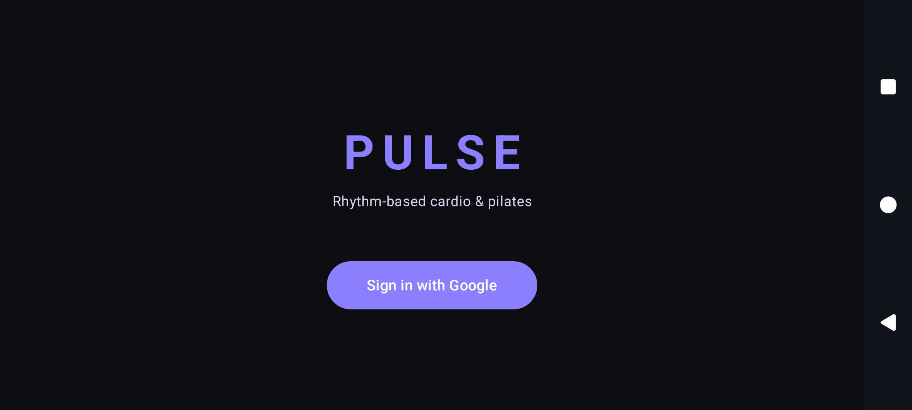

# Pulse

Pulse is an Android prototype for guided, rhythm-based cardio and Pilates sessions. A signed-in user can browse workout levels, preview the sequence, complete timed exercise and rest segments with music and haptic cues, and save a result through a separate backend API.

## Project status

This repository is an **Android client prototype**, not a deployed or production-ready product. It depends on services that are not included here: Supabase Auth, a Google OAuth client, and a Pulse backend API.

| Area | Status | What the code currently does |
| --- | --- | --- |
| Google sign-in | Implemented, configuration required | Exchanges a Google ID token with Supabase Auth and stores the session locally. |
| Level catalogue | Implemented, backend required | Fetches levels, categories, user details, and best attempts from the API. |
| Workout flow | Implemented | Shows a countdown, timed exercise/rest segments, local audio, pause/restart controls, haptics, coherent exercise demonstrations, and an FFT visualization of app playback. |
| Camera coaching | Experimental, opt-in | Processes front-camera frames on-device with ML Kit. It checks full-body visibility and gives simple pose cues for jumping jacks and lunges; frames are not saved or uploaded by the client. |
| Scoring | Prototype logic | Uses camera movement quality to weight active-time points when coaching is enabled, or time-based scoring when the user continues without camera. This is motivational feedback, not a medical or professional form assessment. |
| Accuracy | Experimental | Reports the average confident pose-quality sample for a camera-coached session. Low-confidence or incomplete poses do not receive full credit. |
| Result/profile persistence | Implemented, backend required | Sends attempts and reads profile/best-attempt data through authenticated API calls. |
| Production deployment | Not provided | No production backend, public API endpoint, Play Store release, or uptime claim is included in this repository. |

## Main workflow

1. Sign in with Google through Supabase Auth.
2. Fetch the current user, workout levels, categories, and best scores from the backend.
3. Select and preview a level's exercise/rest sequence.
4. Choose camera coaching or a camera-free workout, then complete the timed sequence while Pulse plays bundled audio, displays exercise media, and gives haptic cues.
5. Review the score and submit the attempt to the backend.

## Screenshot



The screenshot is from the implemented debug app running on an Android 36.1 emulator. It shows the real entry screen; the authenticated workflow still requires the external services described below.

## Architecture

The app uses Jetpack Compose for UI and navigation, ViewModels for screen state, Retrofit/OkHttp for the Pulse API, Supabase Auth for sessions, Google Sign-In for identity, and Media3 plus Android's `Visualizer` API for local audio playback and visualization.

The Android client adds the current Supabase access token as a bearer token on API requests. The backend and its persistence layer are separate and are not part of this repository. See [docs/ARCHITECTURE.md](docs/ARCHITECTURE.md) for boundaries and trade-offs.

## Local setup

Requirements:

- JDK 17
- Android SDK 35
- Android Studio or the checked-in Gradle wrapper
- A configured Supabase project, Google OAuth web client, and compatible Pulse backend

The build accepts configuration from `local.properties`, Gradle properties, or environment variables, in that order.

For a local Android emulator, create an untracked `local.properties` file:

```properties
sdk.dir=/absolute/path/to/Android/sdk
supabase.url=https://your-project-ref.supabase.co
supabase.key=your-public-anon-key
google.web.client.id=your-web-client-id.apps.googleusercontent.com
api.base.url=http://10.0.2.2:8080/
```

Only a Supabase **anon/public** key belongs in an Android build. Authorization must be enforced with Supabase Row Level Security and by the backend. Never use a service-role key here.

Then run:

```bash
./gradlew testDebugUnitTest lintDebug assembleDebug
```

A release build requires all four configuration values and rejects a non-HTTPS or local API URL:

```bash
./gradlew assembleRelease
```

## What I built

The Git history currently attributes the Android client code and interaction design to Kriti Agarwal. The work includes the Compose navigation and screens, Supabase/Google authentication integration, authenticated Retrofit client, timed workout engine, audio visualization, haptics, scoring flow, and profile/result states.

Bundled media is tracked separately because its authorship and redistribution terms are not established by Git history. See [docs/ASSET_PROVENANCE.md](docs/ASSET_PROVENANCE.md).

## Important trade-offs

- Configuration is injected at build time through `BuildConfig`. Public client identifiers and an anon key will therefore be extractable from an APK; security cannot depend on hiding them.
- Score is calculated on the client and accepted by the API. It is suitable for a prototype, not a trusted leaderboard.
- The app requests `RECORD_AUDIO` for Android's playback visualizer. The current code does not record, upload, or score microphone audio.
- Authentication and data APIs are network-dependent; there is no offline or demo-data mode.
- The backend contract is coupled directly to DTOs in this client and is not versioned in this repository.

## Known limitations and next steps

- Verify Supabase RLS, OAuth redirect/client configuration, and backend authorization before exposing any service publicly.
- Move trusted scoring and attempt validation to the backend, or clearly keep scoring recreational.
- Replace the fixed accuracy placeholder with validated sensing logic or remove accuracy from the contract.
- Migrate from the deprecated Google Sign-In API to Credential Manager.
- Add meaningful ViewModel, API-contract, and Compose UI tests; the current generated tests do not cover product behavior.
- Confirm or replace every bundled media asset before public release.
- Add authenticated workflow screenshots after the external services can be exercised with synthetic demo data.
- Configure release signing and complete device/accessibility testing before distribution.

## Security and privacy

Do not commit `local.properties`, `.env`, OAuth secrets, service-role keys, signing keys, database files, or production data. Report a suspected vulnerability privately using the process in [SECURITY.md](SECURITY.md).

## License

No open-source license has been selected yet. A root license should be added only after the code license is chosen and the bundled media has either compatible provenance or has been removed/replaced.
